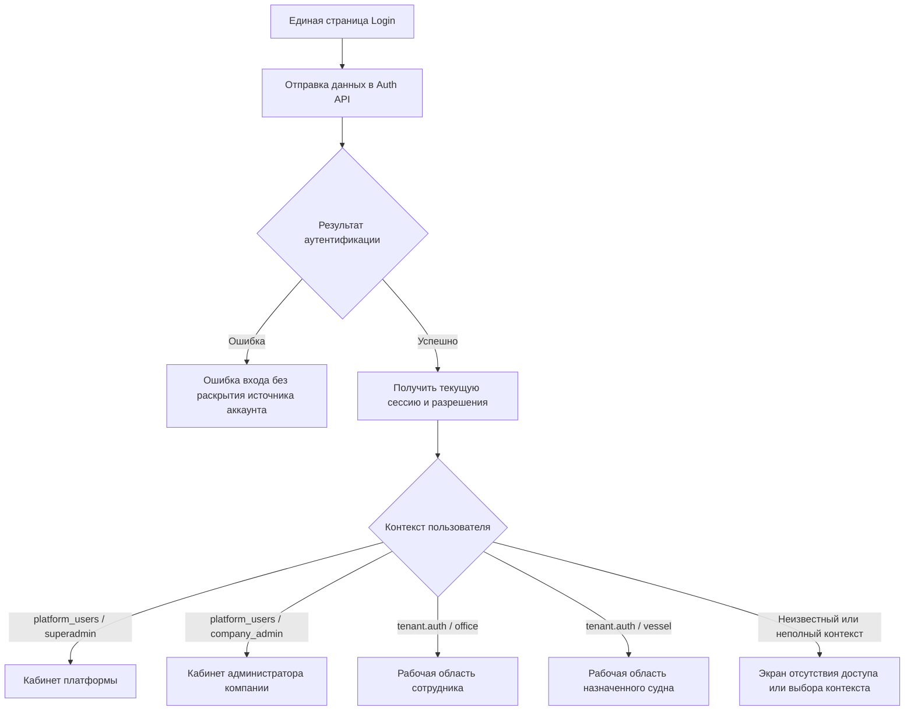

# Единый вход, авторизация и маршрутизация frontend — Draft v0.1

**Статус:** концепция для обсуждения, **не утверждённый API-контракт**. Базируется на [согласованных правилах](DECISIONS.md).
**Дата:** 13.10.2026.

## 1. Главная идея

**Одна публичная страница входа, но два источника учётных записей**:

- `platform_db.platform.platform_users` — `superadmin` и `company_admin`;
- `tenant_db_XXXXXX.auth` — пользователи компании (в текущем UI-прототипе роли `office` / `vessel`; окончательные названия ролей ждут контракт).

Frontend **не выбирает таблицу** и не определяет административную роль на основании email или значения радио-кнопки. Его задача — принять учётные данные, передать их **согласованному сервису аутентификации** и обработать подтверждённый сервером результат.

Ни прямого подключения к БД, ни получения строк подключения из `tenant_connections` браузер не делает.

## 2. Предлагаемый процесс единого входа



**Согласовано:** единая форма и разделение источников учётных записей.
**Предположение frontend:** четыре типа стартовых рабочих областей. Фактические имена ролей, перечень разрешений и количество tenants для одного администратора определяются позднее.

Существующий переключатель «суперадминистратор / администратор» на **демо** остаётся как тестовая функция; в производственной форме такого выбора быть не должно.

## 3. Предлагаемая модель клиента

Данные после успешного входа должны быть достаточными для выбора интерфейса. Пример **формы frontend-модели**, не буквальный ответ API:

```ts
type AccountSource = 'platform_users' | 'tenant.auth';
type EntryRole = 'superadmin' | 'company_admin' | 'office' | 'vessel';

interface CurrentPrincipal {
  userId: string;                // непрозрачный ID, выдаваемый сервером
  accountSource: AccountSource;   // определяет сервер
  role: EntryRole;               // окончательный справочник ролей уточнить
  companyId?: string;            // сервером разрешённый контекст
  tenantId?: string;             // логический ID; НЕ имя/секрет физической БД
  permissions: string[];         // сервер подтверждает права
}

type AuthState =
  | { status: 'checking' }
  | { status: 'anonymous' }
  | { status: 'authenticated'; principal: CurrentPrincipal }
  | { status: 'error'; message: string };
```

Для роли `vessel` назначения судов и детальные разрешения запрашиваются из API, отвечающего за `tenant.auth`/данные судов, и **не задаются произвольно из URL**.

`tenantId` — понятие frontend-контекста. Если API возвращает иной идентификатор, адаптер преобразует его; физический `tenant_db_000001` не превращается в URL подключения или параметр безопасности.

## 4. Предлагаемые маршруты

Это **логические будущие маршруты**, а не существующие URL статического демо.

| Пользователь | Стартовый маршрут (предложение) | Что видит |
| --- | --- | --- |
| Не авторизован | `/login` | Единая страница входа |
| `platform_users:superadmin` | `/platform` | Platform Dashboard и доступные функции суперадмина |
| `platform_users:company_admin` | `/company` | Администрирование назначенной компании |
| `tenant.auth:office` | `/workspace` | Рабочие модули в пределах разрешённых функций компании |
| `tenant.auth:vessel` | `/workspace/my-vessel` | Функции и данные назначенного судна |
| Авторизован, нет разрешения | `/forbidden` | Объяснение ограничения без раскрытия чужих данных |
| Сессия недействительна | `/login` | Повторный вход; при необходимости сообщение об истёкшей сессии |

Для будущих модулей можно предусмотреть маршрут вида `/workspace/:moduleKey/...`, но **нельзя утверждать список вложенных путей до моделей и прав отдельных модулей**. Реальный механизм роутера (SPA/MPA) также открыт.

**Текущий статический UI** остаётся по адресам `modules/auth/login.html`, `modules/platform/index.html`, `modules/tenant/index.html`; его `#dashboard` и другие hash-маршруты **не** являются утверждёнными production URL.

## 5. Правила проверки доступа на frontend

Перед открытием защищённого экрана:

1. При запуске приложения или обновлении вкладки — проверить текущую серверную сессию. До ответа отображать нейтральное состояние **Loading**, а не чужую страницу.
2. Если сессии нет — перейти на `/login`. Не переносить туда секретные данные в query string.
3. Если сессия есть — сверить `accountSource`, роль, tenant-контекст и требуемые `permissions`.
4. Сформировать навигацию по разрешениям и активным модульным подпискам, которые сообщил сервер.
5. Для запроса данных использовать соответствующий **module API service**, не доступ к физической БД и не строки подключения.
6. При `401` перепроверить/завершить сессию; при `403` отобразить «нет доступа»; при отсутствии подписки — отдельное состояние модуля; при ошибке API — Retry/объяснение без утечки внутренней инфраструктуры.

Проверки видимости меню **не являются защитой данных**. Сервер должен повторно проверять права и границы tenant на **каждом запросе**. Данные разных tenants не смешивать в одном клиентском кеше.

## 6. Предлагаемый frontend-модуль Auth

Логические обязанности, без выбора фреймворка и реализации backend:

```text
frontend/
  auth/
    auth-service         # signIn, getCurrentSession, signOut
    auth-state           # checking / anonymous / authenticated / error
    permission-policy    # правила показа UI на основе серверных permissions
    route-resolver       # безопасный начальный маршрут
    route-guard          # защита экранов frontend
  services/
    platform-*           # запросы к Platform API
    tenant-*             # запросы к API tenant-модулей
```

Это **концептуальная структура**, а не поручение сейчас создавать файлы frontend или перестраивать `modules/`.

## 7. Минимальные операции для будущего API-согласования

| Операция | Назначение | Статус |
| --- | --- | --- |
| `signIn(credentials)` | Отправка учётных данных; источник аккаунта определяет backend | Предложение |
| `getCurrentSession()` | Получить идентичность, разрешения, разрешённые контексты | Предложение |
| `signOut()` | Завершить сессию на сервере и очистить клиентское состояние | Предложение |
| `getCompanyModuleAccess(context)` | Получить доступность модулей по лицензии системы и подпискам | Предложение |
| `getAssignedVessels(context)` | Получить разрешённые пользователю суда, где применимо | Предложение |

**Пути HTTP, поля запросов, механика cookie/токенов и коды ошибок не утверждены.** API может иметь общую точку входа и внутреннюю маршрутизацию к `platform_users` / `tenant.auth` — это должен подтвердить отдел backend.

## 8. Безопасность и UX-состояния

- Не хранить реальные пароли, секреты БД и строки подключений в `localStorage`, `sessionStorage`, HTML или URL.
- Способ хранения сессии определяется контрактом. Предпочтительный для обсуждения вариант — защищённая серверная cookie (`HttpOnly`, `Secure`, подходящий `SameSite`) с проработкой CSRF; **ещё не согласовано**.
- Ошибки входа не должны раскрывать, в каком источнике зарегистрирован email.
- Предусмотреть состояния: проверка сессии, ошибка входа, истёкшая сессия, запрещённый маршрут, нет tenant-контекста, недоступен API, нет права на систему, не подключён модуль, нет назначенных судов.
- Deep link после входа можно восстановить только если маршрут и tenant-контекст **разрешены сервером**.

## 9. Открытые вопросы перед реализацией

1. **Как API различает пользователей** двух источников без выбора роли на форме, включая совпадающие email?
2. Администратор компании закреплён за **одной компанией** или может выбирать несколько компаний? Правило «одна компания — одна tenant_db» само по себе этого не решает.
3. Для `tenant.auth` обязательна одна роль или возможны несколько ролей/разрешений?
4. Кто выдаёт tenant-контекст, права на конкретные суда и доступные модули в ответе сессии?
5. При каких статусах **системной лицензии** вход блокируется, а при каких недоступны только подписные модули?
6. Каков контракт URL, ошибок и безопасного хранения сессии?
7. Будет ли frontend полноценным SPA или набором модульных страниц, и как сервер поддержит deep links?

## 10. Критерии готовности следующей версии

Архитектура авторизации может считаться согласованной **для реализации**, когда есть подтверждение источников идентичности, формат ответов Auth API, роли/permissions, правила tenant-контекста, сессионная модель и матрица стартовых маршрутов. До этого **ничего из этого документа не заменяет демо-логику и не считается работающим backend**.
